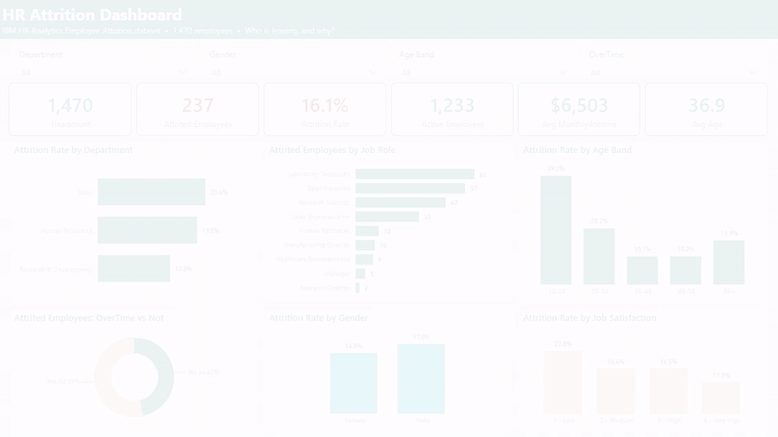
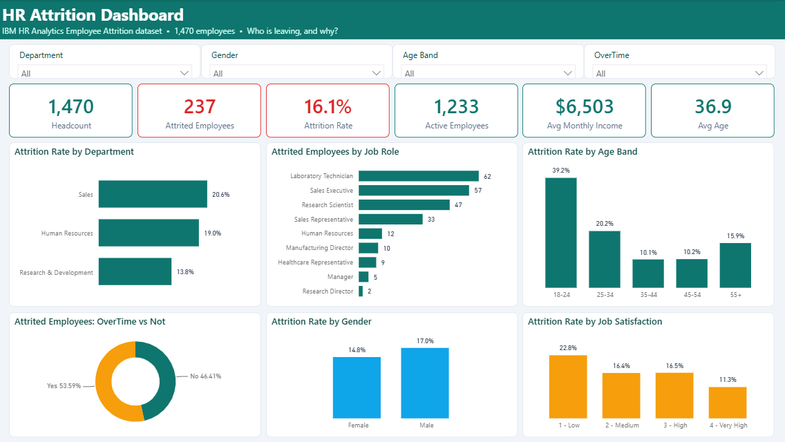
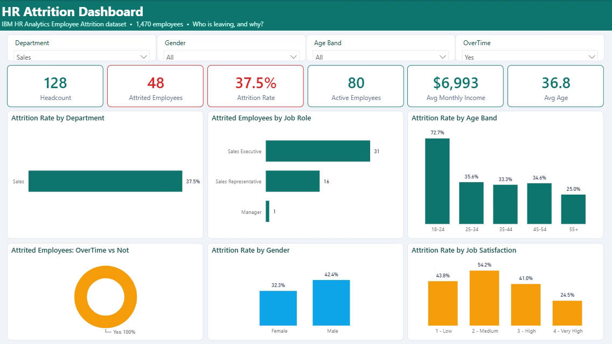
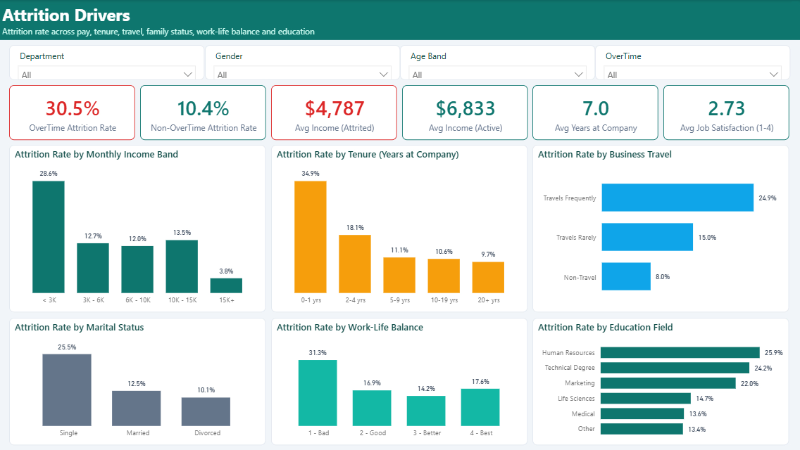
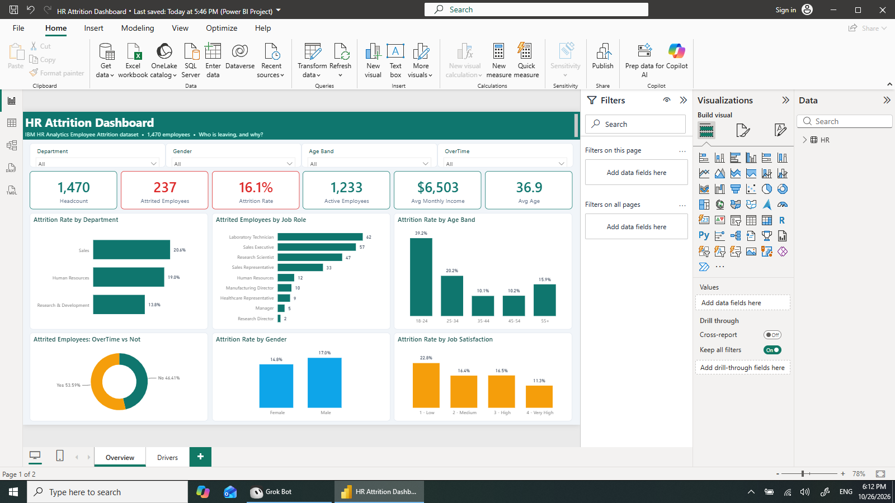

# 📉 HR Attrition Analytics: Power BI Case Study

> **Who is leaving the company, and why?** An interactive two-page Power BI dashboard that turns 1,470 employee records into a clear picture of where attrition happens, what drives it, and what HR can do about it.


-6E40C9)
-64748B)



🎬 **Demo video (MP4, 40 s):** [`assets/hr-attrition-demo.mp4`](assets/hr-attrition-demo.mp4), recorded in Power BI Desktop. It shows both pages and the slicers drilling into the Sales + OverTime hotspot.

---

## 📌 Table of contents
1. [Executive summary](#-executive-summary)
2. [Business problem](#-business-problem)
3. [Solution and approach](#-solution-and-approach)
4. [Dashboard walkthrough](#-dashboard-walkthrough)
5. [Key insights](#-key-insights)
6. [Recommendations for HR](#-recommendations-for-hr)
7. [Data model and Power Query](#-data-model-and-power-query)
8. [DAX measures](#-dax-measures)
9. [How to open and run](#-how-to-open-and-run)
10. [Repository structure](#-repository-structure)
11. [Skills demonstrated](#-skills-demonstrated)
12. [Data source and license](#-data-source-and-license)
13. [Author](#-author)

---

## 🧾 Executive summary

| KPI | Value |
|---|---|
| Headcount | **1,470** |
| Employees who left | **237** |
| **Attrition rate** | **16.1%** |
| Active employees | 1,233 (retention 83.9%) |
| Avg monthly income | $6,503 |
| Avg age / avg tenure | 36.9 yrs / 7.0 yrs |

**The headline:** attrition is **not** spread evenly. It concentrates in employees who **work overtime (30.5% vs 10.4%)**, are **early in their tenure (34.9% in years 0–1)**, are **young (39.2% for ages 18–24)**, and are **low paid (28.6% under $3K/month)**. The worst segment the dashboard surfaces, **Sales employees on overtime, loses 37.5%** of its people.

---

## 🎯 Business problem

HR leadership sees people leaving but cannot say **where** attrition is concentrated or **why** it happens. That has a cost:

- **Replacement cost:** recruiting, onboarding and ramp-up time for every leaver.
- **Lost productivity and knowledge:** teams run short-staffed while roles stay open.
- **Morale and workload:** the people who stay pick up the extra work. In this data, that kind of overload (overtime) is itself the strongest driver of exits.

In this dataset the 237 leavers earned a combined **$1.13M per month** (about **$13.6M a year** in salary), and all of that capacity has to be re-hired.

**Questions the stakeholders (CHRO, HR business partners, department heads) asked:**

1. How big is the problem? What are the headcount, the number of leavers and the attrition rate?
2. Which departments, job roles, age groups and genders are hit hardest?
3. Does **overtime** drive people out, and by how much?
4. Are we losing people because of **pay**, **tenure**, **travel**, **work-life balance** or **satisfaction**?
5. Where should HR spend its retention budget first?

---

## 🛠 Solution and approach

| Step | What I did |
|---|---|
| **1. Data** | Loaded the IBM HR Analytics Employee Attrition dataset (1,470 rows, 35 columns) from CSV. It is a **fictional sample dataset created by IBM data scientists**, not real company data (see [license](#-data-source-and-license)). |
| **2. Clean and shape (Power Query M)** | Typed all columns and dropped 3 constant columns (`EmployeeCount`, `Over18`, `StandardHours`). Added an `AttritionFlag` (1/0) column, plus **Age**, **Income** and **Tenure** bands with hidden sort keys so axes read in logical order. Relabelled the 1–4 survey scores as readable text (for example "1 - Low"). |
| **3. Model** | One clean, import-mode fact table (`HR`) with 43 columns. The data has one row per employee and no lookup tables, so a single table is the simplest correct model. |
| **4. DAX** | 13 measures in a `KPIs` display folder: headcount, leavers, attrition and retention rates, `CALCULATE`-based overtime and leaver-vs-active comparisons, and averages. |
| **5. Design** | Two pages with one story each. **Overview** answers *how big and where*, and **Drivers** answers *why*. Six KPI cards sit on top of a 3×2 grid of charts on each page. A custom teal theme (`HRTealTheme.json`) is used, with **red for leaver metrics and teal for healthy ones**. Every chart uses **attrition rate (%)** instead of raw counts wherever group sizes differ, so small groups aren't hidden. |
| **6. Interactivity** | Four synced dropdown slicers (Department, Gender, Age Band, OverTime) on both pages, plus cross-filtering between visuals. |
| **7. Version control** | Saved as a **Power BI Project (`.pbip`)**, so the model (`model.bim`), the M queries, the DAX and the report layout are plain text and reviewable in Git. |
| **8. Validation** | Every KPI shown in the dashboard was cross-checked against the raw CSV in Python/pandas, and the numbers match. |

---

## 🖥 Dashboard walkthrough

The report has **2 pages, each with 17 visuals**: a header, 4 slicers, 6 KPI cards and 6 charts.

### Page 1: Overview ("How big is the problem, and where is it?")



**Slicers (top row, dropdowns):** `Department` · `Gender` · `Age Band` · `OverTime`. Every card and chart on the page responds to them, so a department head can look at only their own team in one click.

**KPI cards:**

| Card | Measure | Value (unfiltered) | Why it's there |
|---|---|---|---|
| Headcount | `Total Employees` | 1,470 | Size of the population |
| Attrited Employees *(red)* | `Attrited Employees` | 237 | Absolute number of exits |
| Attrition Rate *(red)* | `Attrition Rate %` | 16.1% | The core health metric |
| Active Employees | `Active Employees` | 1,233 | Who is still here |
| Avg Monthly Income | `Avg Monthly Income` | $6,503 | Pay context for the selection |
| Avg Age | `Avg Age` | 36.9 | Workforce age profile |

**Charts:**

| Visual | What it shows | Decision it supports |
|---|---|---|
| **Attrition Rate by Department** (bar, sorted desc) | Sales 20.6% · HR 19.0% · R&D 13.8% | Which department heads need a retention plan first |
| **Attrited Employees by Job Role** (bar, sorted desc) | Laboratory Technician 62 · Sales Executive 57 · Research Scientist 47 · Sales Representative 33 … Research Director 2 | Where the *volume* of exits is, which tells recruiting where to keep pipelines warm |
| **Attrition Rate by Age Band** (column) | 18–24: **39.2%** · 25–34: 20.2% · 35–44: 10.1% · 45–54: 10.2% · 55+: 15.9% | Target early-career programmes and retirement planning |
| **Attrited Employees: OverTime vs Not** (donut) | **53.6%** of all leavers worked overtime, though only 28% of staff do | Shows overtime is over-represented among leavers |
| **Attrition Rate by Gender** (column) | Male 17.0% · Female 14.8% | Checks for a gender gap in retention, which here is small |
| **Attrition Rate by Job Satisfaction** (column) | 1 - Low: **22.8%** · 2: 16.4% · 3: 16.5% · 4 - Very High: 11.3% | Connects engagement-survey scores to actual exits |

**Slicers in action:** setting `Department = Sales` and `OverTime = Yes` isolates the biggest hotspot. That's 128 employees, 48 leavers and a **37.5%** attrition rate, and it rises to 72.7% for 18–24-year-olds in that group. Sales Executives (31) and Sales Representatives (16) make up almost all of these leavers.



### Page 2: Attrition Drivers ("Why are people leaving?")



**Slicers:** the same four (`Department`, `Gender`, `Age Band`, `OverTime`), so any driver can be checked for one segment.

**KPI cards:**

| Card | Measure | Value | Why it's there |
|---|---|---|---|
| OverTime Attrition Rate *(red)* | `Overtime Attrition Rate` | **30.5%** | Attrition among people who work overtime |
| Non-OverTime Attrition Rate | `Non-Overtime Attrition Rate` | 10.4% | Baseline for comparison, about **3×** lower |
| Avg Income (Attrited) *(red)* | `Avg Income - Attrited` | **$4,787** | What leavers were paid |
| Avg Income (Active) | `Avg Income - Active` | $6,833 | What stayers are paid, a **$2,046/month gap** |
| Avg Years at Company | `Avg Years at Company` | 7.0 | Tenure context |
| Avg Job Satisfaction (1–4) | `Avg Job Satisfaction` | 2.73 | Engagement context |

**Charts:**

| Visual | What it shows | Decision it supports |
|---|---|---|
| **Attrition Rate by Monthly Income Band** | < 3K: **28.6%** · 3K–6K: 12.7% · 6K–10K: 12.0% · 10K–15K: 13.5% · 15K+: 3.8% | Pay benchmarking for the lowest band |
| **Attrition Rate by Tenure** | 0–1 yrs: **34.9%** · 2–4: 18.1% · 5–9: 11.1% · 10–19: 10.6% · 20+: 9.7% | Onboarding and first-year engagement programmes |
| **Attrition Rate by Business Travel** | Frequently: **24.9%** · Rarely: 15.0% · Non-Travel: 8.0% | Travel rotation and travel-allowance policy |
| **Attrition Rate by Marital Status** | Single: **25.5%** · Married: 12.5% · Divorced: 10.1% | Shows the segment most likely to leave; it overlaps with young, early-tenure staff |
| **Attrition Rate by Work-Life Balance** | 1 - Bad: **31.3%** · 2 - Good: 16.9% · 3 - Better: 14.2% · 4 - Best: 17.6% | Act on people who report poor work-life balance |
| **Attrition Rate by Education Field** | Human Resources 25.9% · Technical Degree 24.2% · Marketing 22.0% · Life Sciences 14.7% · Medical 13.6% · Other 13.4% | Shows which talent pools are hardest to keep |

### Built in Power BI Desktop (PBIP)



---

## 💡 Key insights

All numbers come from the dataset as shown in the dashboard, cross-checked in pandas.

1. **Overtime is the #1 lever.** 30.5% of overtime workers leave, against 10.4% of everyone else (127 of 416 vs 110 of 1,054). Overtime workers are 28% of staff but **54% of leavers**. If they left at the non-overtime rate, about **84 fewer people** would have left, which would cut total attrition by more than a third.
2. **Pay matters most at the bottom.** Leavers earned **$4,787/month vs $6,833** for stayers. The < $3K band loses **28.6%** of its people (113 of 395), while the $15K+ band loses only 3.8%.
3. **The first year is the danger zone.** **34.9%** of employees with 0–1 years at the company leave (75 of 215), and the rate falls steadily to 9.7% at 20+ years.
4. **Young employees leave the most.** The 18–24 band has 39.2% attrition (38 of 97), about 4× the 35–44 band (10.1%).
5. **Sales is the hotspot department (20.6%),** and **Sales + overtime reaches 37.5%** (48 of 128). By volume, **Laboratory Technicians (62)** and **Sales Executives (57)** account for the most leavers.
6. **Travel and life stage add risk.** Frequent travellers leave at 24.9% vs 8.0% for non-travellers, and single employees leave at 25.5% vs about 10–13% for married or divorced employees.
7. **Low satisfaction and poor work-life balance predict exits.** Job satisfaction "Low" means 22.8% attrition vs 11.3% at "Very High". Work-life balance "Bad" means 31.3%.

---

## ✅ Recommendations for HR

| # | Recommendation | Evidence in the dashboard | KPI to track |
|---|---|---|---|
| 1 | **Cap and monitor overtime**, starting with Sales. Add staffing or rotation where overtime is chronic. | OT 30.5% vs 10.4%; Sales + OT 37.5% | `Overtime Attrition Rate` by department, every month |
| 2 | **Review pay for the < $3K band** (entry-level roles like Lab Technician and Sales Rep). | 28.6% attrition in < $3K; leavers paid $2,046/month less | Attrition by income band |
| 3 | **Strengthen onboarding and first-year engagement** with a buddy programme and 30/60/90-day check-ins. | 0–1 yrs tenure 34.9% | Attrition for the 0–1 yrs tenure band |
| 4 | **Build an early-career track** with a clear path from level 1, mentoring and learning budgets. | 18–24 band 39.2%; 25–34 band 20.2% | Attrition by age band |
| 5 | **Rethink frequent-travel roles** through rotation, travel allowances or remote alternatives. | Frequent travel 24.9% vs 8.0% | Attrition by travel group |
| 6 | **Act on survey signals.** Treat "Low" job satisfaction and "Bad" work-life balance scores as early-warning flags for manager follow-up. | 22.8% and 31.3% attrition | Attrition by satisfaction and work-life balance |

---

## 🧱 Data model and Power Query

**Model:** a single import-mode table, `HR`, with one row per employee (1,470 rows, 43 columns: 32 source columns plus 11 derived). It has no relationships, because the source is one flat, employee-grain table. A star schema (for example `DimDepartment`, `DimJobRole` and `DimDate`) would only add value with more sources or a time dimension. It's listed under next steps.

```
┌────────────────────────────── HR (fact, import) ──────────────────────────────┐
│ EmployeeNumber · Age · Gender · MaritalStatus · Department · JobRole ·         │
│ JobLevel · MonthlyIncome · OverTime · BusinessTravel · YearsAtCompany · …      │
│ + AttritionFlag · Age Band · Income Band · Tenure Band (+ hidden sort keys) ·  │
│   Job Satisfaction Level · Environment Satisfaction Level ·                    │
│   Work-Life Balance Level · Business Travel                                    │
│ 13 DAX measures (display folder: KPIs)                                         │
└────────────────────────────────────────────────────────────────────────────────┘
```

**Power Query (M) steps** (see `HR Attrition Dashboard.SemanticModel/model.bim`):

| # | Step | Detail |
|---|---|---|
| 1 | Source | `Csv.Document(File.Contents(...))`, UTF-8, 35 columns |
| 2 | Promote headers | |
| 3 | Change types | 8 text columns, the rest whole numbers (`en-US`) |
| 4 | Remove constant columns | `EmployeeCount`, `Over18`, `StandardHours` (the same value in every row) |
| 5 | `AttritionFlag` | `if [Attrition] = "Yes" then 1 else 0`, so the measures stay simple sums |
| 6 | `Age Band` + sort | 18-24, 25-34, 35-44, 45-54, 55+ |
| 7 | `Income Band` + sort | < 3K, 3K-6K, 6K-10K, 10K-15K, 15K+ |
| 8 | `Tenure Band` + sort | 0-1, 2-4, 5-9, 10-19, 20+ yrs (from `YearsAtCompany`) |
| 9 | Survey labels | `Job Satisfaction Level`, `Environment Satisfaction Level`, `Work-Life Balance Level` (1–4 mapped to text) |
| 10 | `Business Travel` | Travels Rarely / Travels Frequently / Non-Travel |

Excerpt of the band logic:

```powerquery
AddIncBand = Table.AddColumn(AddAgeSort, "Income Band", each
    if [MonthlyIncome] < 3000 then "< 3K"
    else if [MonthlyIncome] < 6000 then "3K - 6K"
    else if [MonthlyIncome] < 10000 then "6K - 10K"
    else if [MonthlyIncome] < 15000 then "10K - 15K"
    else "15K+", type text)
```

---

## 🧮 DAX measures

All 13 measures, exactly as they appear in `model.bim` (display folder `KPIs`):

| Measure | DAX | Format | Used on |
|---|---|---|---|
| Total Employees | `COUNTROWS ( HR )` | `#,0` | Overview card |
| Attrited Employees | `SUM ( HR[AttritionFlag] )` | `#,0` | Overview card, Job Role chart, OverTime donut |
| Active Employees | `[Total Employees] - [Attrited Employees]` | `#,0` | Overview card |
| Attrition Rate % | `DIVIDE ( [Attrited Employees], [Total Employees] )` | `0.0%` | Overview card and all rate charts |
| Retention Rate % | `1 - [Attrition Rate %]` | `0.0%` | Available for ad-hoc analysis |
| Avg Monthly Income | `AVERAGE ( HR[MonthlyIncome] )` | `$#,0` | Overview card |
| Avg Age | `AVERAGE ( HR[Age] )` | `0.0` | Overview card |
| Avg Years at Company | `AVERAGE ( HR[YearsAtCompany] )` | `0.0` | Drivers card |
| Overtime Attrition Rate | `CALCULATE ( [Attrition Rate %], HR[OverTime] = "Yes" )` | `0.0%` | Drivers card |
| Non-Overtime Attrition Rate | `CALCULATE ( [Attrition Rate %], HR[OverTime] = "No" )` | `0.0%` | Drivers card |
| Avg Job Satisfaction | `AVERAGE ( HR[JobSatisfaction] )` | `0.00` | Drivers card |
| Avg Income - Attrited | `CALCULATE ( [Avg Monthly Income], HR[Attrition] = "Yes" )` | `$#,0` | Drivers card |
| Avg Income - Active | `CALCULATE ( [Avg Monthly Income], HR[Attrition] = "No" )` | `$#,0` | Drivers card |

**Design notes:**
- `DIVIDE` instead of `/` avoids divide-by-zero errors when slicers empty a segment.
- Rate measures are built from base measures (`[Attrited Employees]`, `[Total Employees]`), so every chart uses one consistent definition of attrition.
- `CALCULATE` with a column filter overrides only the `OverTime` or `Attrition` context and keeps the other slicers working.

---

## ▶️ How to open and run

**Requirements:** Power BI Desktop for Windows (free). Built with version 2.157 (Microsoft Store).

1. Clone the repo: `git clone https://github.com/nishanttyagi28/hr-attrition-powerbi-dashboard.git`
2. Double-click **`HR Attrition Dashboard.pbip`**.
3. **Point the query at your CSV.** The source uses the author's absolute path
   `C:\Users\Admin\Documents\HR-Attrition-Dashboard\data\WA_Fn-UseC_-HR-Employee-Attrition.csv`.
   If your copy is elsewhere, go to **Transform data → `HR` → Advanced Editor**, change the path in the `Source` step to your local `data\WA_Fn-UseC_-HR-Employee-Attrition.csv`, then **Close & Apply**. You can also use **Transform data → Data source settings → Change Source…**.
4. Click **Refresh** on the Home ribbon. The data cache (`.pbi/cache.abf`) isn't committed, so the first open needs a refresh.
5. If Power BI offers to upgrade the project format, either choice works.

**Quickest option:** download [`HR Attrition Dashboard.pbix`](HR%20Attrition%20Dashboard.pbix) (single file, data included) and open it in Power BI Desktop. No clone or path change needed.

---

## 📁 Repository structure

```
hr-attrition-powerbi-dashboard/
├── HR Attrition Dashboard.pbip              # ▶ open this in Power BI Desktop
├── HR Attrition Dashboard.Report/           # report layout, 2 pages, visuals, theme
│   ├── report.json
│   ├── definition.pbir
│   └── StaticResources/RegisteredResources/HRTealTheme.json
├── HR Attrition Dashboard.SemanticModel/    # data model: Power Query M + 13 DAX measures
│   ├── model.bim
│   └── definition.pbism
├── data/
│   └── WA_Fn-UseC_-HR-Employee-Attrition.csv
└── assets/
    ├── hr-attrition-demo.gif                # inline demo
    ├── hr-attrition-demo.mp4                # full demo video
    ├── overview.png                         # page 1 screenshot
    ├── drivers.png                          # page 2 screenshot
    ├── drilldown-sales-overtime.png         # slicer drill-down example
    └── powerbi-desktop-pbip.png             # Power BI Desktop view
```

---

## 🧰 Skills demonstrated

**Power BI Desktop** · **Power Query (M)** data cleaning and feature engineering (banding, flags, sort-by columns) · **DAX** (`CALCULATE`, `DIVIDE`, measure branching) · **data modelling** · **dashboard UX** (KPI cards, consistent color semantics, synced slicers) · **HR analytics** (attrition rate, segmentation, driver analysis) · **business storytelling** (problem → insight → recommendation) · **Python/pandas** for validating the numbers · **Git/GitHub** with the PBIP format

**Next steps:** a star schema with dimension tables, a date dimension with hire and exit dates to track monthly attrition trends, an attrition-risk score (logistic regression), and publishing to the Power BI Service with row-level security per department.

---

## 📜 Data source and license

- **Dataset:** IBM HR Analytics Employee Attrition & Performance. It is a **fictional** dataset created by IBM data scientists for analytics practice, so the insights here demonstrate the method and aren't findings about a real company.
- **File obtained from:** [IBM/employee-attrition-aif360](https://github.com/IBM/employee-attrition-aif360) (`data/emp_attrition.csv`, byte-identical to the Kaggle file `WA_Fn-UseC_-HR-Employee-Attrition.csv`). Originally published on [Kaggle](https://www.kaggle.com/datasets/pavansubhasht/ibm-hr-analytics-attrition-dataset).
- **License** (as stated by the IBM repo): the database is under the [Open Database License (ODbL) v1.0](https://opendatacommons.org/licenses/odbl/1-0/) and its contents under the [Database Contents License (DbCL) v1.0](https://opendatacommons.org/licenses/dbcl/1-0/). The CSV is redistributed here unmodified, with attribution. This project is not affiliated with or endorsed by IBM.

---

## 👤 Author

**Nishant Tyagi**, Data Analyst
[](https://www.linkedin.com/in/nishant-tyagi-7aa458356/)
[](https://github.com/nishanttyagi28)

If you found this useful, a ⭐ is appreciated. Feedback is welcome via Issues.
